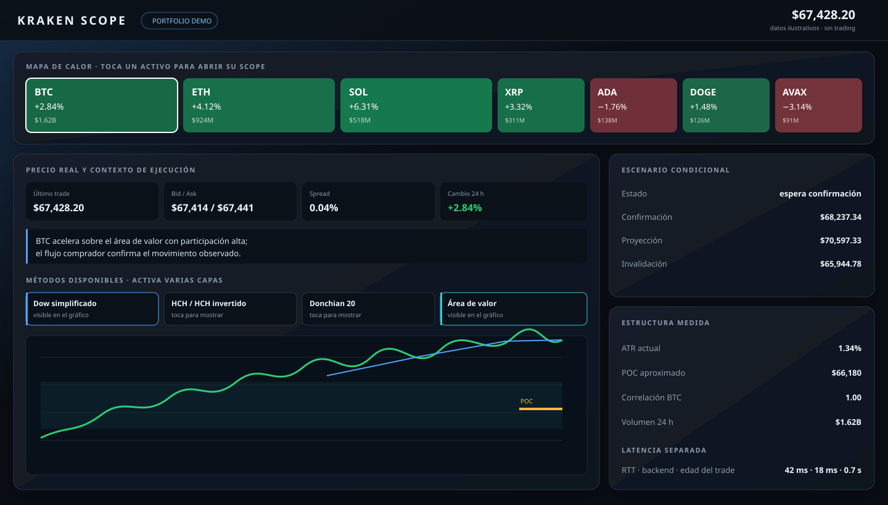

# Kraken Scope

**A local-first market-structure dashboard for Kraken.** It turns public exchange data into a
clear view of price, latency, volume, liquidity, volatility and conditional technical scenarios.
It never connects to a trading account and never executes orders.

[Open the interactive portfolio demo](https://marcelaguilar999-bit.github.io/kraken-scope/) ·
[Documentación completa en español](LEEME.md)



## What it shows

- Market heatmap sized by 24-hour USD volume and colored by daily change.
- Last trade, bid, ask, midpoint, spread and independently measured latency components.
- Volume profile, POC and 70% value area drawn without charting dependencies.
- Real aggressive order flow from Kraken trades, order-book liquidity and open interest context.
- Historical adverse excursion in ATR units to make stop placement easier to reason about.
- Toggleable Dow, H&S, Donchian, moving-average, value-area, volume, flow and liquidity layers.

Technical scenarios are deliberately conditional: each one exposes confirmation, projection and
invalidation. They describe observable market structure; they are not buy/sell signals.

## Run locally

```bash
git clone https://github.com/marcelaguilar999-bit/kraken-scope.git
cd kraken-scope
python3 -m venv .venv
source .venv/bin/activate
pip install -r requirements.txt
python app.py
```

Open <http://127.0.0.1:8777>. No API key is required: Kraken Scope uses public spot and futures
endpoints only.

## Test

```bash
python -m unittest discover -s tests -v
```

The current suite covers analytics, open-candle exclusion, input validation, API health,
concurrent-safe OI persistence, IPv6 allowlisting and technical-pattern detection.

## Architecture

| File | Role |
|---|---|
| `app.py` | Flask API, Kraken clients, caching, analytics and persistence safeguards |
| `technical.py` | Pivots, simplified Dow structure, H&S and conditional scenarios |
| `static/index.html` | Dependency-free responsive dashboard and canvas charts |
| `docs/index.html` | Static, synthetic-data portfolio demo for GitHub Pages |
| `tests/` | Deterministic unit and API tests |

## Safety and scope

- No credentials, balances or account permissions.
- No order execution and no claim of predictive certainty.
- Runtime state (`oi_historico.json`, logs and caches) stays outside Git.
- The GitHub Pages demo is clearly labeled and uses illustrative data rather than a live feed.

Built by **Marcel Aguilar** as a decision-support interface for discretionary trading.
